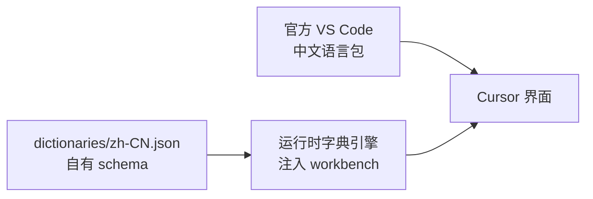

# cursor-zh

> **English summary** — `cursor-zh` is an unofficial, community-maintained Simplified Chinese localization tool for [Cursor](https://cursor.com). It works in two layers: the **official VS Code Chinese language pack** (installed through Cursor's extension CLI when missing, never bundled here) covers the UI Cursor inherits from VS Code, and a **small runtime dictionary engine injected into Cursor's workbench** covers Cursor-specific strings. Every file it touches is backed up as a versioned `.bak` first, `product.json` checksums are recalculated, and a one-click `restore` is provided. Coverage is partial; macOS is the only supported platform today (Apple Silicon and Intel; Windows is planned but untested); Cursor auto-updates overwrite the patch. Cursor only — Claude is explicitly out of scope. On macOS the installer applies an ad-hoc signature by default (`--no-codesign` skips it). This project is **not affiliated with, endorsed by, or supported by Anysphere or Cursor**. Use at your own risk.

---

**cursor-zh** 是一个把 Cursor 界面变成简体中文的社区工具。它不是官方项目，与 Anysphere / Cursor 没有任何隶属关系，遇到界面问题请先回滚再向 Cursor 官方反馈。

- 只做 **Cursor**，不做 Claude，也不做其它编辑器。
- 先支持 **macOS**（Apple Silicon / Intel），Windows 在计划中。
- 覆盖率是**部分**的，并且 Cursor 自动更新后补丁会被覆盖，需要重新安装。

## 目录

- [这是什么](#这是什么)
- [特性](#特性)
- [快速开始](#快速开始)
- [CLI 命令](#cli-命令)
- [工作原理](#工作原理)
- [覆盖率与当前状态](#覆盖率与当前状态)
- [回滚与卸载](#回滚与卸载)
- [已知限制](#已知限制)
- [常见问题](#常见问题)
- [来源与许可](#来源与许可)
- [参与贡献](#参与贡献)
- [免责声明](#免责声明)

## 这是什么

Cursor 是基于 VS Code 内核的编辑器，因此它的界面其实由两部分组成：

1. **VS Code 共用的界面**：编辑器、文件树、命令面板、设置页的大部分、扩展市场等。
2. **Cursor 自研的界面**：Agent 面板、Composer、Cursor 设置页里的 AI 相关选项、云端 Agent、用量统计等。

`cursor-zh` 对这两部分分别处理：共用部分用官方的 VS Code 中文语言包解决，Cursor 自研部分用一个运行时字典引擎在界面渲染时替换英文文案。这就是下文说的 **A + B 混合方案**。

## 特性

- **两层汉化（A + B）**：官方语言包覆盖 VS Code 共用界面（CLI 会在缺失时自动安装），运行时字典覆盖 Cursor 专有界面。
- **自有字典格式**：`dictionaries/zh-CN.json` 使用本项目自己的带版本号 schema，条目与来源可校验、可追溯。
- **先备份后改动**：注入前把原始 `workbench.js` / `workbench.html` 写成同版本 `.bak`；`restore` 直接用它们还原。
- **校验和一致**：修改 `product.json` 后同步重算这两个文件的校验和，避免 macOS 报告应用"已损坏"。
- **一条命令回滚**：`cursor-zh restore` 撤销注入，不需要你记住任何路径。
- **状态可见**：`status` 显示是否已汉化、Cursor 版本、备份是否存在及是否与当前版本匹配；`coverage` 给出估算覆盖率与未收录候选；`doctor` 做环境自检。
- **无遥测**：不收集任何数据，不上报任何统计信息。
- **可审计**：全部代码与字典都在仓库里，安装脚本做了什么可以直接读。

## 快速开始

### 环境要求

- macOS（Apple Silicon 或 Intel）已验证；Windows 有安装脚本但尚未验证。
- 已安装官方 Cursor，默认路径 `/Applications/Cursor.app`；装在别处请用 `--app` 指定。
- Node.js **>= 18**（`package.json` 中的 `engines` 约束）。

### 三种安装方式

**1. 交给你的 Cursor / Claude agent（适合已经在用 agent 的人）**

把仓库里的 [skills/cursor-zh/SKILL.md](skills/cursor-zh/SKILL.md) 发给你的 agent，或把 `skills/cursor-zh` 复制到它的 skills 目录，然后说“按 cursor-zh skill 帮我安装”。Skill 会先运行 `doctor`、`status` 和 `install --dry-run`，把要改的文件列给你，**征得你同意后才执行安装**；失败时会先 `restore`，不会手改 Cursor 文件。

**2. 双击脚本（适合不想碰终端的人）**

- macOS：双击 `install.command`。如果系统拦截，右键 → 打开。
- Windows：双击 `install.cmd`（它会调用 `install.ps1`）。Windows 路径尚未完整验证，遇到问题请先 `restore` 并提 Issue。

双击脚本会检查 Node.js、运行 `doctor`、调用 `install`，并在结束时保留窗口显示结果。安装前仍会要求你确认。

**3. 命令行**

见下方“从源码安装”。

### 安装（从源码）

项目目前尚未发布到 npm，请从源码运行：

```bash
git clone https://github.com/Javey-Li/cursor-zh.git
cd cursor-zh
node cli/index.js help            # 直接运行
# 或者
npm link                          # 之后可以直接用 cursor-zh 命令
```

> **当前状态**：0.2.x 早期版本，五个命令都已可用，但版本适配与覆盖范围仍在推进。具体行为以 `cursor-zh help` 和 `cli/`、`packages/` 下的实际代码为准。

### 首次使用

以下命令假设你已 `npm link`；没有的话把 `cursor-zh` 换成 `node cli/index.js`。

```bash
cursor-zh doctor              # 1. 自检：Node 版本、Cursor 路径、词典、补丁器
cursor-zh install --dry-run   # 2. 只打印目标路径与词典统计，不写文件
cursor-zh install             # 3. 备份 → 注入 → 更新校验和 → 重签
cursor-zh status              # 4. 确认是否已打补丁、备份是否存在
```

仓库已附带构建好的字典（`dictionaries/zh-CN.json`，2997 条唯一词条 + 244 条模式）。只有在你改动了构建输入、或字典缺失时才需要重新生成：

```bash
python3 tools/build_dictionary.py   # 等于 npm run build:dict
```

安装完成后**完全退出并重新打开 Cursor**（`Cmd + Q`，不是关窗口），部分文案需要打开一次设置页或切换面板后才会刷新。

> **A 层（VS Code 共用界面）由 CLI 自动处理**：安装时如果检测不到微软的 `Chinese (Simplified)` 语言包，会调用 Cursor 自带的扩展 CLI 安装，并写入 `locale.json`。如果自动安装失败（例如离线或企业代理），再到扩展面板手动安装，并用 `Cmd + Shift + P` → `Configure Display Language` 选择中文。

## CLI 命令

| 命令 | 作用 |
| --- | --- |
| `cursor-zh install` | 备份 `workbench.js` / `workbench.html`（写为 `*.bak`），把词典引擎与内联字典追加进 `workbench.js`，更新 `product.json` 校验和，清除隔离属性并做 ad-hoc 重签。 |
| `cursor-zh restore` | 用同版本的 `.bak` 还原 `workbench.js` / `workbench.html`，重算校验和并重签。还原成功后 `.bak` 会被删除。 |
| `cursor-zh status` | 显示 Cursor 版本、是否已打补丁、备份是否存在、备份版本与当前版本是否一致。 |
| `cursor-zh coverage` | 启发式扫描 Cursor 安装包，估算词典覆盖率，并列出词典未收录的候选字符串。 |
| `cursor-zh doctor` | 环境自检：Node >= 18、`product.json` 是否存在、词典能否加载、补丁器能否加载、当前补丁状态。 |

参数：

| 参数 | 适用于 | 说明 |
| --- | --- | --- |
| `--app PATH` | 全部命令 | 指定 Cursor 路径（`.app` 或其 `Contents/Resources/app` 均可），默认 `/Applications/Cursor.app`。 |
| `--dry-run` | `install` | 只打印目标路径与词典统计，不写任何文件。 |
| `--force` | `install` | 检测到其它汉化补丁（例如 `Cursor_Localization.js`）时仍然继续。**不建议**：两套注入会叠加。 |
| `--limit N` | `coverage` | 未收录候选的显示条数，默认 100。 |
| `--json` | `coverage` | 以 JSON 输出，便于脚本处理。 |
| `--help` / `-h` | 全部命令 | 打印帮助；不带参数运行也会打印帮助（其中包含版本号）。 |

`install` 默认会在写入前列出计划并请求确认；`--yes`（或 `--force`）跳过确认，`--dry-run` 只预览。所有写入都需要对 Cursor 安装目录的权限；macOS 的 TCC 拦截会提示你去「隐私与安全性」授权，工具会等待并重试。

状态与引擎词典默认放在 `~/.cursor-zh/`（`state.json`、`engine/dictionary.zh-CN.json`）。备份不是独立目录，而是写在 Cursor 安装目录里的 `workbench.js.<版本>.bak` / `workbench.html.<版本>.bak`。

## 工作原理



1. **A 层：官方语言包。** 安装微软发布的 VS Code 中文语言包（版本需与 Cursor 的 VS Code 内核匹配），覆盖编辑器、文件树、命令面板、设置页等共用界面。这层复用官方翻译，质量稳定，且不需要我们维护上万条 VS Code 文案。
2. **B 层：运行时注入。** 构建期把 `dictionaries/zh-CN.json` 转成引擎词典；安装期把引擎代码与 `window.__I18N_TERMS__`（词条）内联进 `out/vs/code/electron-sandbox/workbench/workbench.js`，界面渲染时按"精确匹配 → 正则模式 → 保留英文"的顺序替换。
3. **必要的副作用。** 注入方式是把引擎代码和词典追加到 `workbench.js`，不新增 inline script；在 Cursor 3.27.22 上 `workbench.html` 不会被改动，CSP 保持原样。文件被修改后原签名失效，工具默认用 `codesign --force --deep --sign -` 做 ad-hoc 重签（`--no-codesign` 可跳过）。
4. **安全网。** 注入前把原始文件写成同版本的 `.bak`；改完 `product.json` 后重算这两个文件的 SHA-256（base64）；`restore` 直接用 `.bak` 还原。

更多设计细节（组件划分、安装/还原时序、版本探测、失败模式）见 [docs/ARCHITECTURE.md](docs/ARCHITECTURE.md)。

## 覆盖率与当前状态

**我们不声称完整覆盖。** 当前状态：

- 最终字典：**2997 条唯一词条 + 244 条正则模式**（见 `dictionaries/manifest.json` 的实际计数）。
- 其中本项目新增 **311 条词条**（合并去重后贡献 310 条）与 **5 条模式**；其余来自社区种子（2123 条）和两个 MIT 词典：Uncle-Gao 360 条、lsh2253823857 204 条。
- 已覆盖的典型区域：Cursor 设置页、Agent / Composer 面板、自动化与远程控制、浏览器/网络相关设置、用量与统计、PR 审查、安全相关提示。
- 仍未覆盖或只能部分覆盖：新版本引入的新字符串、动态拼接的文案、部分原生/AX 层面的文本（例如 macOS 原生菜单栏）、以及尚未验证的页面。条数多不等于覆盖率高——覆盖率取决于 Cursor 版本里实际有多少字符串命中。

判断你这台机器上的实际情况，请运行：

```bash
cursor-zh coverage
```

它是**启发式扫描**：从 Cursor 的安装包里抽取出看起来像界面文案的字符串，再和词典比对，给出估算覆盖率和未收录候选。数字只用于发现"下一批该补什么"，不是精确的覆盖率指标。

每次 Cursor 升级后，新增的英文界面都会回到英文状态，这是正常现象——需要重新执行 `cursor-zh install`，并按需补充字典。

## 回滚与卸载

按推荐顺序：

1. **一条命令回滚（推荐）**

   ```bash
   cursor-zh restore
   ```

   先完全退出 Cursor 再执行。它会用同版本的 `.bak` 还原 `workbench.js` / `workbench.html`，重算校验和并重签，然后**删除 `.bak`**——也就是说，`restore` 之后再想回滚就没有就地备份了，只能靠整包备份或重装。

2. **手动还原**

   如果 `restore` 报"未发现任何汉化备份"（例如 Cursor 更新时清理了 `.bak`），可以在
   `/Applications/Cursor.app/Contents/Resources/app/out/vs/code/electron-sandbox/workbench/`
   下查看是否还有 `workbench.js.<版本>.bak` / `workbench.html.<版本>.bak`，手动拷回原文件名，再重算 `product.json` 里的校验和。

3. **重装 Cursor（最彻底）**

   从 Cursor 官网下载安装包覆盖安装，可以确保回到干净状态。

无论用哪种方式，界面语言设置本身是 Cursor 的设置项，如果曾把显示语言切成中文，需要在 `Configure Display Language` 里改回英文；官方中文语言包不想要了，在扩展面板里卸载即可。

卸载工具本身：删除仓库目录（或 `npm unlink cursor-zh`）即可，再按需清理 `~/.cursor-zh/`。工具不会安装后台服务、常驻进程或登录项。

## 已知限制

- **Cursor 自动更新会覆盖补丁。** 更新后需要重新 `cursor-zh install`；把这一步当成升级流程的一部分。更新也可能顺带清掉 `.bak`，所以升级前想回滚请先 `restore` 或整包备份。
- **macOS 原生菜单栏可能保持英文。** 顶部菜单（File / Edit / View / Window / Help）由 AppKit 与 `Info.plist` 的本地化资源决定，注入 workbench 无法完全覆盖。
- **代码签名会变。** 修改后的应用不再有 Anysphere 的原始签名，工具默认会用 `codesign --force --deep --sign -` 打 ad-hoc 签名让 Cursor 仍能启动（不希望重签时加 `--no-codesign`）。部分企业 MDM / 安全软件会拦截 ad-hoc 签名的应用，此时请 `restore` 或重装。
- **CSP 在 3.27.22 上保持不变。** 注入通过追加到 `workbench.js` 实现，不需要放宽 `workbench.html` 的 CSP；如果未来 Cursor 改成必须 inline 注入，可能需要在 `workbench.html` 上调整 CSP，届时会在 release notes 说明。
- **版本敏感，且没有兼容表。** 工具只读取 `product.json` 的版本号，不做"支持版本矩阵"判断；一旦 Cursor 改了 workbench 的打包方式，注入就会失败。
- **Windows 尚未支持。** 代码里有 Windows 路径分支，但未经测试，也不在本仓库的支持范围内。
- **不处理 Claude，也不处理其它编辑器。** 本仓库只针对 Cursor。
- **不以"完整汉化"为目标。** 目标是"常用界面可用中文"，边角文案可能长期保留英文。

## 常见问题

**Q：安装后界面部分还是英文？**
A：先确认已用 `Cmd + Q` 完全退出并重启；再跑 `cursor-zh coverage` 看这些文案是否被词典收录。没收录就是没覆盖，欢迎按 [CONTRIBUTING.md](CONTRIBUTING.md) 补词条。另外确认 A 层语言包是否安装（`install` 通常会自动处理）。原生菜单栏属于已知限制。

**Q：Cursor 更新后变回英文了？**
A：自动更新会重写应用文件，补丁被覆盖。重新执行 `cursor-zh install` 即可。若 `status` 提示备份版本与当前版本不一致，先 `restore` 再 `install`。

**Q：安装时提示"检测到另一套汉化补丁"？**
A：说明 Cursor 里还留着旧工具的注入（例如 `Cursor_Localization.js`）。请先用原工具还原（例如 `bash 取消汉化_Mac.sh`），再运行本工具。`--force` 能让它继续，但两套注入会叠加，不建议。

**Q：macOS 提示"Cursor 已损坏，无法打开"？**
A：这是修改应用后签名变化的结果。工具已做过 ad-hoc 重签，若仍被拦截：完全退出 Cursor，先试 `cursor-zh restore`；不行就恢复整包备份或从官网重装。企业 MDM 环境可能直接禁止 ad-hoc 签名，这种情况下建议不要使用本工具。

**Q：会影响 Cursor 的账号、云端 Agent 或项目文件吗？**
A：不会修改你的项目文件、账号或云端状态。工具只改动 Cursor 安装目录内的界面资源，且全部有备份。

**Q：会收集我的使用数据吗？**
A：不会。没有遥测，没有统计上报。安装过程不联网；只有构建字典的脚本会去下载 MIT 词典与种子数据，可用 `CURSOR_ZH_OFFLINE=1` 完全禁用联网。

## 来源与许可

本项目的许可边界说清楚，避免误解：

| 部分 | 来源 | 许可 |
| --- | --- | --- |
| `cli/`、`tools/`、字典 schema、本文档 | 本项目原创 | MIT |
| `packages/core`、`packages/patcher-cursor` 的补丁引擎 | vendored 自 [Uncle-Gao/Live-Translator-Hub](https://github.com/Uncle-Gao/Live-Translator-Hub) | MIT（保留原版权声明） |
| 字典种子数据 | 社区翻译数据（上游 vibepm666 字典），仅作为种子/翻译记忆使用并注明出处 | 上游未提供 LICENSE |
| 部分字典条目 | [Uncle-Gao/Live-Translator-Hub](https://github.com/Uncle-Gao/Live-Translator-Hub)、[lsh2253823857/cursor-i18n-tool](https://github.com/lsh2253823857/cursor-i18n-tool) | MIT |
| 本项目新增的 311 条词条与 5 条模式 | 本项目原创 | MIT |
| VS Code 中文语言包 | Microsoft | CLI 在缺失时通过 Cursor 扩展 CLI 安装；不随仓库分发 |

本项目**没有**复制上游 vibepm666 的代码，只把其社区翻译数据作为种子，并在自有 schema 下重新组织、校验和补充。完整来源、逐项许可以及 A + B 混合方案的理由见 [docs/PROVENANCE.md](docs/PROVENANCE.md)；版权声明汇总见根目录 `NOTICE`。

## 参与贡献

- 补词条、改翻译、报 bug、写文档都欢迎，先读 [CONTRIBUTING.md](CONTRIBUTING.md)。
- 安全问题请**不要**开公开 issue，按 [SECURITY.md](SECURITY.md) 私下报告。
- 提交前请跑 `npm test` 和 `node tools/validate-dictionary.js`，CI 会跑同样的检查。

## 免责声明

本项目是非官方社区项目，与 Anysphere / Cursor 官方无任何隶属、合作或背书关系，也不代表官方立场。Cursor 是 Anysphere 的产品，相关商标与版权归其权利人所有。

使用本工具意味着你会修改本地 Cursor 应用的安装文件，可能使其代码签名失效、触发系统安全提示、或在 Cursor 升级后出现界面异常。**请自行承担风险**，并在操作前确保重要工作已保存、必要时已备份 `Cursor.app`。作者与贡献者不对因使用本工具造成的任何直接或间接损失负责。如果 Cursor 官方提供正式的中文界面，请优先使用官方方案。
