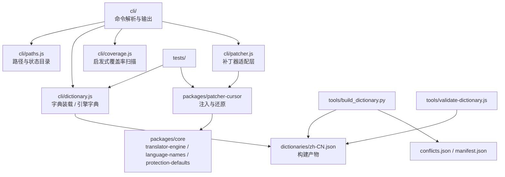
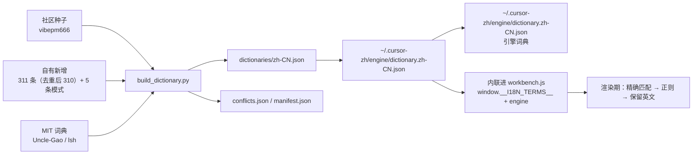
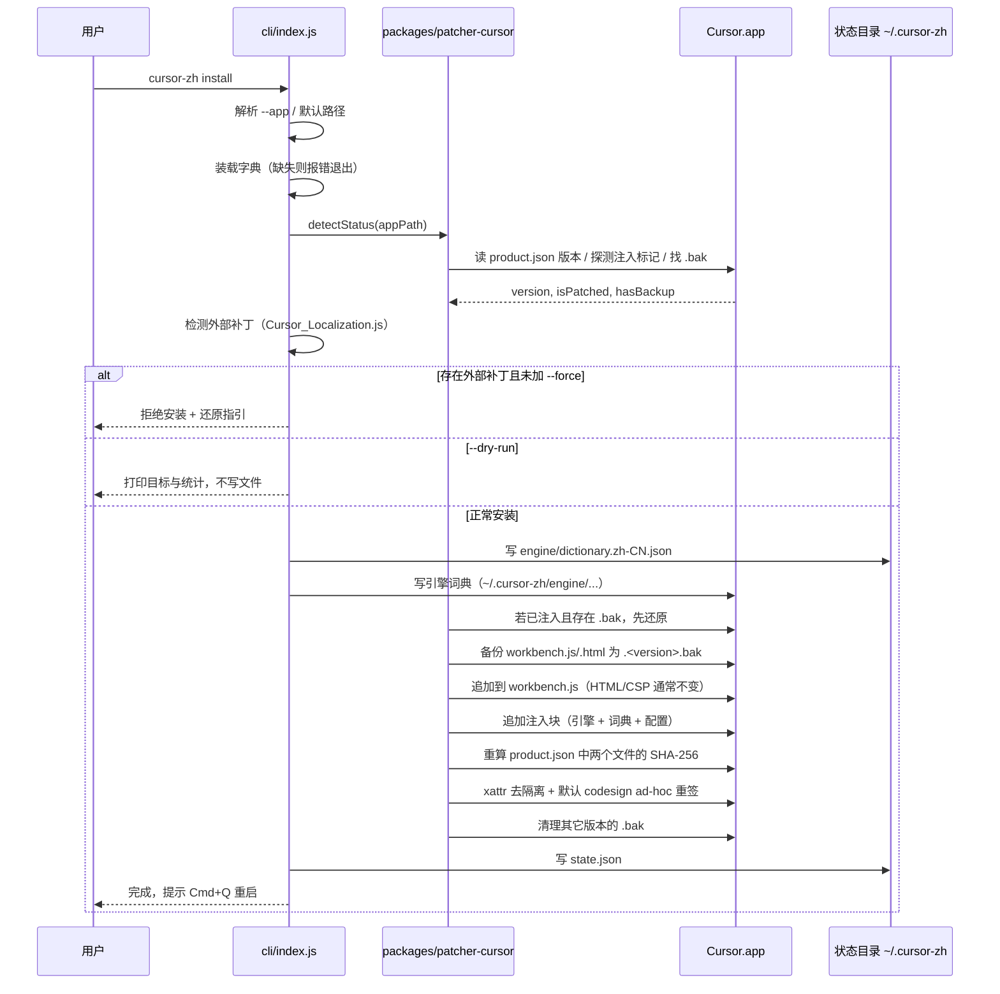
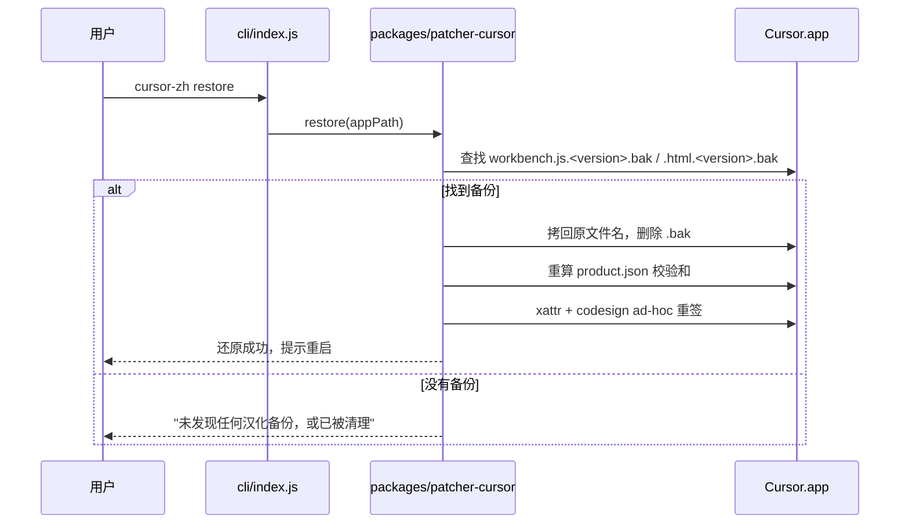

# 架构说明

本文描述 `cursor-zh` 的组件划分、数据流与必须遵守的不变量，以当前代码为准。仓库仍在 0.1.x，实现会继续演进：当实现与本文不一致时，以代码为准，并在同一个 PR 里更新本文。

## 目标与非目标

目标：在 macOS 上把 Cursor 的界面变成尽可能多的简体中文，并且**任何时刻都能回到原始状态**。

非目标：不支持 Claude 与其它编辑器；不做多语言；不改 Cursor 的更新机制；不分发 Cursor 二进制或微软语言包 VSIX。

## 组件

| 组件 | 职责 | 关键约束 |
| --- | --- | --- |
| `cli/index.js` | 解析命令与参数（`install` / `restore` / `status` / `coverage` / `doctor` / `help`），输出人类可读结果，决定退出码。 | 薄入口：不直接写 Cursor 文件，所有写入通过 `cli/patcher.js` → `packages/patcher-cursor`。 |
| `cli/paths.js` | 解析 Cursor 路径（`--app` → `.app` → `Contents/Resources/app` → `resources/app` → 父目录下含 `cursor` 的子目录），推导状态目录 `~/.cursor-zh`。 | Windows / Linux 分支存在但未验证；不支持的平台不应被文档宣称可用。 |
| `cli/dictionary.js` | 校验并装载 `dictionaries/zh-CN.json`，转换成引擎字典（`entries` 摊平 + `regex` 表，`flags: i` 转成 `(?i)` 前缀）。 | 字典缺失即报错，不静默降级为空字典。 |
| `cli/coverage.js` | 从 `workbench.desktop.main.js`、`workbench.glass.main.js`、`out/main.js`、`workbench.js` 与 `molten/dist/renderer/assets/*` 里抽字符串字面量，过滤代码噪音后与字典比对。 | 只读；结果是**启发式估算**，不是精确覆盖率。 |
| `cli/patcher.js` | 把仓库配置（`targetLanguage: zh-CN`、`activeId: none`、`skip`）整理成 patcher 的调用参数，并转发进度回调。 | 不复制 patcher 逻辑；patcher 缺失时给出可修复的错误提示。 |
| `packages/core` | `translator-engine.js`（运行时替换引擎）、`language-names.js`（语言名/代码）、`protection-defaults.json`（不翻译的保护词与模式）。 | vendored 自 MIT 上游，只做 Cursor-only 裁剪；保留声明（见 `NOTICE`）。 |
| `packages/patcher-cursor` | 备份、注入、CSP 兼容（3.27 上通常 no-op）、校验和更新、`xattr` + 可选 ad-hoc `codesign`、还原、webview 注入（CLI 未启用）。 | 幂等、可逆；每次注入前按版本取备份。 |
| `dictionaries/` | 构建产物：`zh-CN.json`、`conflicts.json`、`manifest.json`。 | 由 `tools/build_dictionary.py` 生成，不手改结构；来源与冲突可追溯。 |
| `tools/` | `build_dictionary.py`（合并种子与 MIT 词典）、`validate-dictionary.js`（结构与来源校验）。 | 只读仓库与本地缓存；不写用户机器上的 Cursor 文件。 |
| `tests/` | `node --test tests/*.test.js`。 | 涉及文件系统的用例必须用临时目录。 |

依赖方向：`cli → patcher → core`，`tools → dictionaries`。`tools/` 不被运行时依赖，避免把开发期逻辑带进安装路径。

## 数据流

1. **构建期**：`tools/build_dictionary.py` 读取种子、自有新增与 MIT 词典，按 **own > MIT > seed** 的优先级解决冲突，输出确定性字典（键排序、无 wall-clock 时间戳）与冲突/清单文件。
2. **安装期**：`cli/dictionary.js` 把字典摊平成引擎字典，写 `~/.cursor-zh/engine/dictionary.zh-CN.json`，然后把引擎代码、`window.__I18N_CONFIG__` 与词典一起追加进 `workbench.js`。
3. **运行期**：引擎先查精确匹配，再按少量正则替换，都不命中就保留英文。**宁可保留英文，也不要错译**——错译比未译更难排查。
4. **覆盖率**：`coverage` 不依赖运行期统计，而是静态扫描安装包里的字符串字面量，给出"还有哪些候选没收录"，所以它既能在未安装时运行，也不会误报为"已覆盖"。

语言包（A 层）由 `install` 在缺失时通过 Cursor 扩展 CLI 安装，并写入 `locale.json`；`status` 会报告语言包版本。离线或代理失败时，才需要用户手动在扩展市场安装。

## 安装时序

必须遵守的不变量：

1. **先备份，后写入。** 目标文件以 `workbench.js.<version>.bak` / `workbench.html.<version>.bak` 落盘后，才允许修改。
2. **幂等。** 检测到已注入（标记 `=== 安装期编译内联组装 ===`）且存在同版本 `.bak` 时，先从 `.bak` 还原再重新注入，避免两次注入叠加。
3. **失败即止。** 任一步抛错就停止并向上报告，用户可重新 `install` 或 `restore`；不接受"改了一半"的状态被当成成功。
4. **路径白名单。** 写入只发生在 `out/vs/code/electron-sandbox/workbench/` 下的 `workbench.js` / `workbench.html` 与 `product.json`。
5. **可解释的权限请求。** macOS TCC 拦截时不静默失败，也不自动 `sudo`：提示用户去「隐私与安全性」授权，然后按固定间隔重试，超时报错。

## 还原时序

注意两点：

- **还原依赖 `.bak`。** Cursor 更新时可能清掉旧备份，或备份版本与当前版本不一致（`status` 会提示）。这种情况下 `restore` 无法就地还原，需要整包备份或重装 Cursor。
- **还原会删除 `.bak`。** 还原后不再有就地备份，二次回滚只能靠整包备份。

## 版本探测

| 来源 | 用途 |
| --- | --- |
| `product.json` 的 `version` | 唯一的版本依据：用于备份命名（`<version>.bak`）、状态展示与版本一致性判断。 |
| `workbench.js` 中的注入标记 | 判断"是否已打补丁"。 |
| `workbenchDir` 下的 `.bak` 文件名 | 推断备份版本；与当前版本不同即 `versionMismatch`，提示先 `restore` 再 `install`。 |

当前**没有版本兼容表**：工具不在白名单里判断"这个 Cursor 版本是否受支持"，而是依赖结构探测——目标文件存在、注入点可追加，就继续；结构变了会在写入前后暴露问题。这是有意的取舍（维护矩阵成本高），代价是新版本首装需要人工验证。

`cli/paths.js` 的路径解析顺序：显式 `--app` → `.app` bundle → `Contents/Resources/app` → `resources/app` → 父目录下名字含 `cursor` 的子目录。多个候选都存在时按上述顺序取第一个命中，不在交互里猜测。

## 失败模式

| 现象 | 原因 | 处理 |
| --- | --- | --- |
| `未检测到 Cursor 安装` | 路径不对、非官方安装位置、非 macOS 布局 | 用 `--app` 指定；`doctor` 会打印它实际检查的路径。 |
| `检测到另一套汉化补丁` | `workbench.html` 里还有旧工具的 `Cursor_Localization.js` / `CURSOR_LOCALIZATION_INJECTION` | 先用原工具还原；确认要覆盖时加 `--force`（会导致注入叠加）。 |
| `找不到 dictionaries/zh-CN.json` | 字典未构建 | 运行 `python3 tools/build_dictionary.py`。 |
| macOS 阻止文件操作 | TCC 权限 | 按提示在「隐私与安全性」授权，工具会自动重试；超时则退出后重来。 |
| `codesign` 超时或失败 | 应用体积大、磁盘慢、企业策略禁止 ad-hoc 签名 | 默认超时 2 分钟并有重试；持续失败说明该环境不适合本方案，请 `restore`/重装。 |
| 应用能启动但界面全英文 | A 层语言包未装（`install` 会自动尝试）、注入未生效、或 Cursor 缓存未刷新 | 检查语言包、重启应用；`status` 确认 `已打补丁: 是`。 |
| 部分文案中文、部分英文 | 字典未覆盖该版本的新字符串 | 已知限制；`coverage` 列出缺口，按 `CONTRIBUTING.md` 补充。 |
| 更新后变回英文 | 自动更新重写 `workbench.js` / `workbench.html` | 重新 `install`。 |
| `status` 提示备份版本不一致 | 备份来自旧版本 Cursor | 先 `restore`（若仍有效）再 `install`。 |
| `restore` 报"未发现任何汉化备份" | `.bak` 被更新清理，或之前已还原过 | 手动还原整包备份，或从官网重装。 |
| 校验和不对导致"应用已损坏" | 手动改过 workbench 文件但没更新 `product.json` | 重新 `install`（会重算校验和）或重装。 |
| 字典校验失败 | 结构不符、占位符不匹配、来源未登记 | 按 `validate-dictionary.js` 的报错修构建输入，再重建。 |

## 状态与产物位置

| 路径 | 内容 | 是否可删 |
| --- | --- | --- |
| `~/.cursor-zh/state.json` | 最近一次安装记录（工具版本、Cursor 版本、时间、字典统计） | 可删，只影响诊断信息 |
| `~/.cursor-zh/engine/dictionary.zh-CN.json` | 引擎字典（注入时读取） | 可删，重装会重建 |
| `~/.cursor-zh/engine/dictionary.zh-CN.json` | 引擎词典；由 `install` 生成 | 可删，重装会重建 |
| `Cursor.app/.../workbench/workbench.js.<version>.bak` | 就地备份，`restore` 依赖 | **不要删**，删了就无法就地还原 |
| `Cursor.app/.../workbench/workbench.html.<version>.bak` | 同上 | **不要删** |

日志只在本地产出，不上报；仓库与工具都不包含遥测代码。
